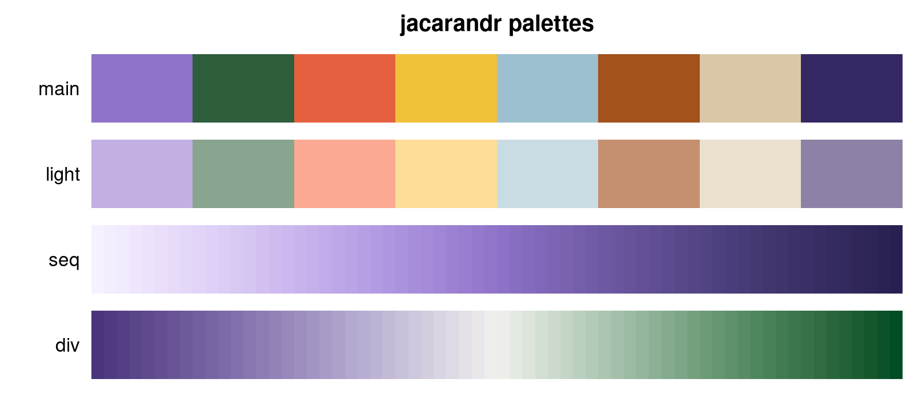
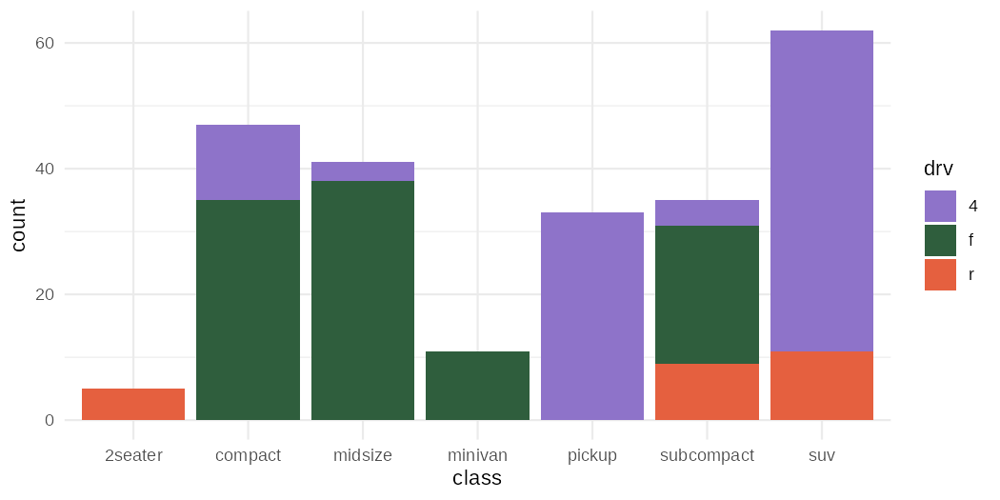
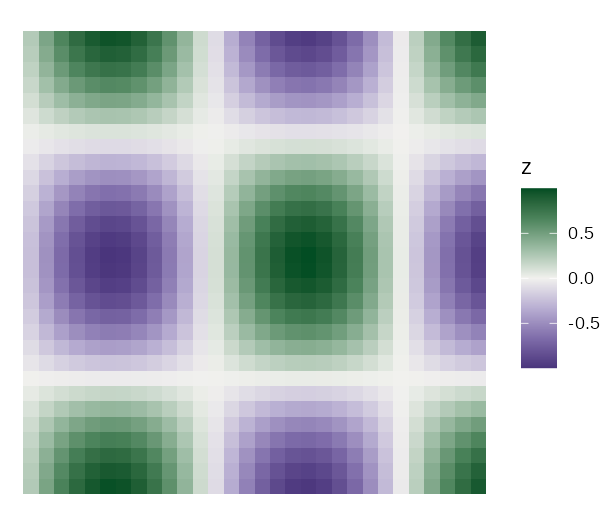

# jacarandr

<!-- badges: start -->
[](https://github.com/jazon7/jacarandr/actions/workflows/R-CMD-check.yaml)
<!-- badges: end -->

Colour palettes inspired by the jacaranda tree, whose violet blooms cover
Australian streets every November, and the trees that flower alongside it:
the red Illawarra flame tree, golden wattle, gum leaves and paperbark.

jacarandr is deliberately small. It has four palettes, one function to get
colours, one to look at them, and ggplot2 scales, all with the same
`reverse` argument.



| Palette   | Type        | Use it for                                          |
|-----------|-------------|-----------------------------------------------------|
| `"main"`  | discrete, 8 | groups in bar charts, points and lines              |
| `"light"` | discrete, 8 | large fills and backgrounds, or pairing with `main` |
| `"seq"`   | sequential  | ordered or continuous data, light to dark jacaranda |
| `"div"`   | diverging   | data with a meaningful centre, such as zero         |

The `"main"` colours are ordered so that the first few are always the most
distinct, and every pair stays distinguishable under simulated red-green and
blue-yellow colour vision deficiency.

## Installation

Install the development version from GitHub:

```r
# install.packages("remotes")
remotes::install_github("jazon7/jacarandr")
```

jacarandr only needs base R. ggplot2 is optional and only needed for the
`scale_*()` functions.

## Usage

### Get colours

```r
library(jacarandr)

jac_pal()                      # all 8 main colours
#> [1] "#8E73C9" "#2F5E3D" "#E5603F" "#EFC23A" "#9CC0CF" "#A3521B" "#D9C7A7"
#> [8] "#352862"

jac_pal(n = 3)                 # the three most distinct
#> [1] "#8E73C9" "#2F5E3D" "#E5603F"

jac_pal(n = 3, reverse = TRUE) # the same three, reversed
#> [1] "#E5603F" "#2F5E3D" "#8E73C9"

jac_pal("seq", n = 5)          # any number from a continuous palette
#> [1] "#F7F1FF" "#B79FE6" "#8E73C9" "#433771" "#282051"

jac_colours("jacaranda", "wattle")  # pick colours by name
#> jacaranda    wattle
#> "#8E73C9" "#EFC23A"
```

They work anywhere a colour vector does, including base graphics:

```r
barplot(1:5, col = jac_pal(n = 5))
image(volcano, col = jac_pal("seq", n = 50))
```

### See colours

```r
jac_show()        # every palette
jac_show("main")  # one palette, labelled with names and hex codes
```


### ggplot2

Discrete scales end in `_d` and continuous scales end in `_c`. Every scale
takes `reverse`, and both British and American spellings work.

```r
library(ggplot2)

ggplot(mpg, aes(class, fill = drv)) +
  geom_bar() +
  scale_fill_jac_d()
```



```r
ggplot(faithfuld, aes(waiting, eruptions, fill = density)) +
  geom_raster() +
  scale_fill_jac_c(reverse = TRUE)

# A diverging palette centred on zero
ggplot(df, aes(x, y, fill = z)) +
  geom_tile() +
  scale_fill_jac_c(palette = "div", midpoint = 0)
```



A discrete palette has 8 colours. If your data has more groups, jacarandr
stops with an error rather than reusing or inventing colours, because readers
cannot reliably tell more than about 8 categories apart. Group the smaller
categories together, or for ordered categories use
`scale_fill_jac_d(palette = "seq")`, which supplies any number of colours.

See `vignette("jacarandr")` for more.

## Licence

MIT
