# jacarandr

<!-- badges: start -->
[](https://github.com/jazon7/jacarandr/actions/workflows/R-CMD-check.yaml)
<!-- badges: end -->

Colour palettes inspired by the jacaranda tree, whose violet blooms cover
Australian streets every November, and the trees that flower alongside it:
the orange-red Illawarra flame tree, golden wattle, glossy figs, lilly pilly
and blue quandong.

<p align="center">
  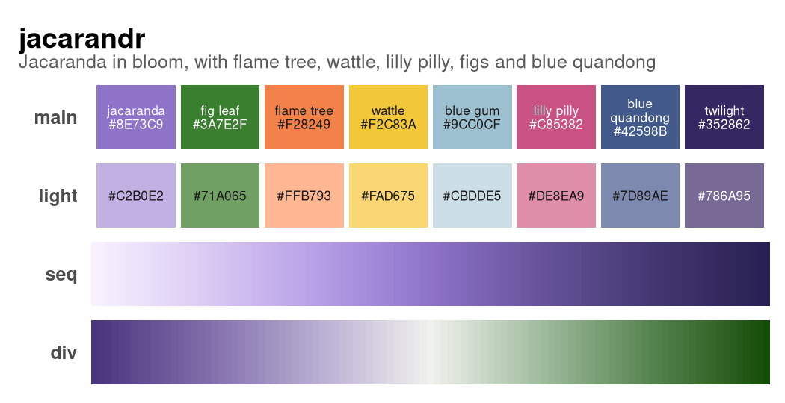
</p>

jacarandr is deliberately small. It has four palettes, one function to get
colours, one to look at them, and ggplot2 scales, all with the same
`reverse` argument.

| Palette   | Type        | Use it for                                          |
|-----------|-------------|-----------------------------------------------------|
| `"main"`  | discrete, 8 | groups in bar charts, points and lines              |
| `"light"` | discrete, 8 | large fills and backgrounds, or pairing with `main` |
| `"seq"`   | sequential  | ordered or continuous data, light to dark jacaranda |
| `"div"`   | diverging   | data with a meaningful centre, such as zero         |

The `"main"` colours are ordered so that the first few are always the most
distinct, and every pair stays distinguishable under simulated red-green and
blue-yellow colour vision deficiency.

## Gallery

<table>
  <tr>
    <td colspan="2">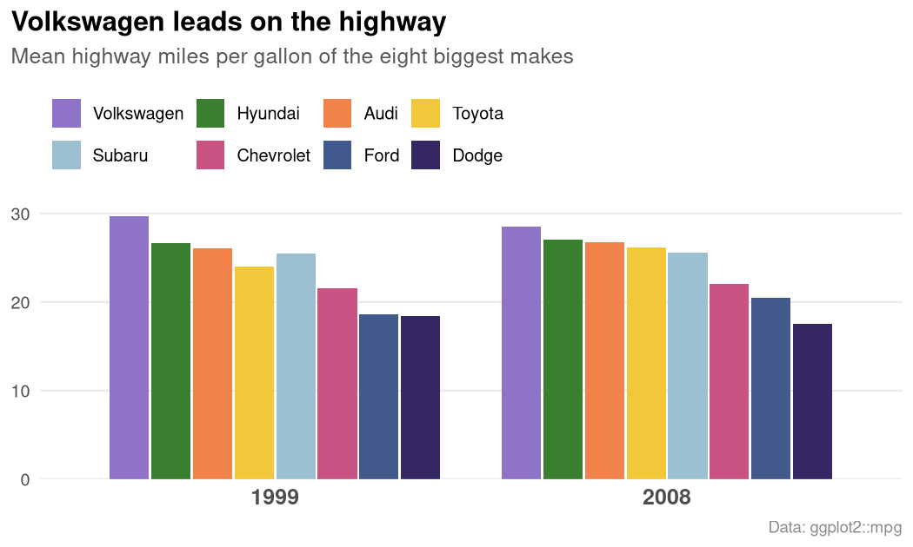</td>
  </tr>
  <tr>
    <td width="50%">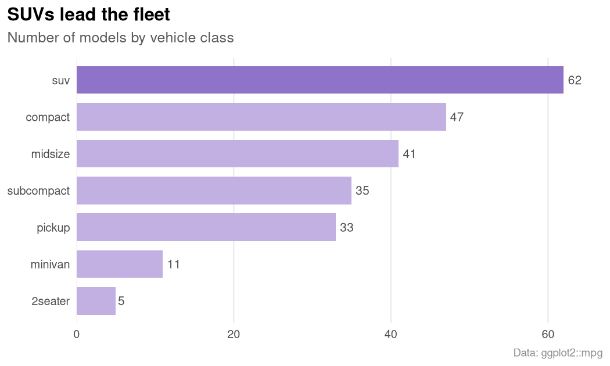</td>
    <td width="50%">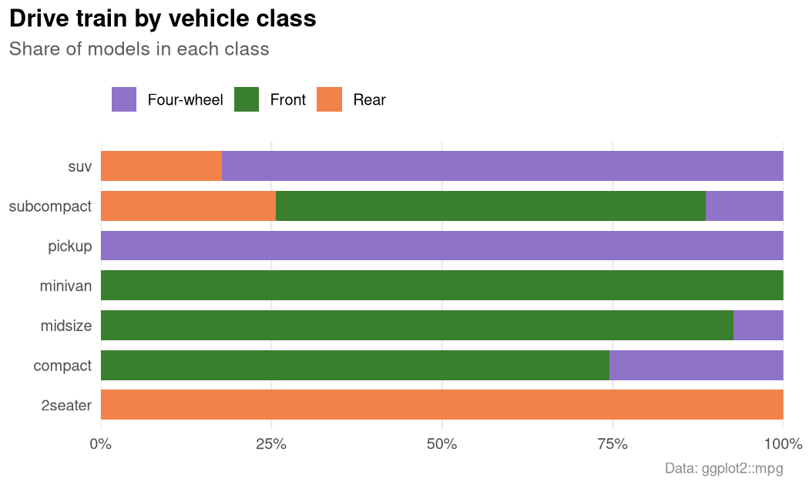</td>
  </tr>
  <tr>
    <td>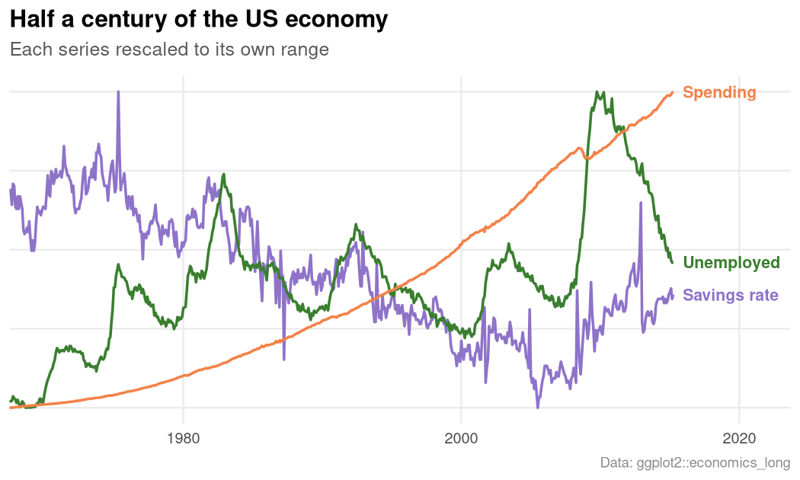</td>
    <td>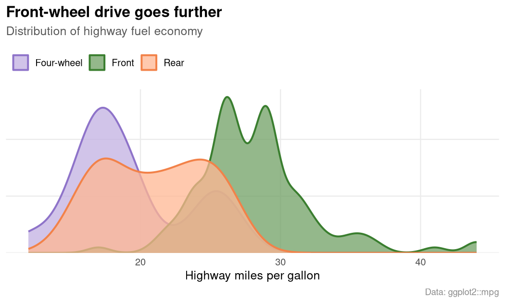</td>
  </tr>
  <tr>
    <td>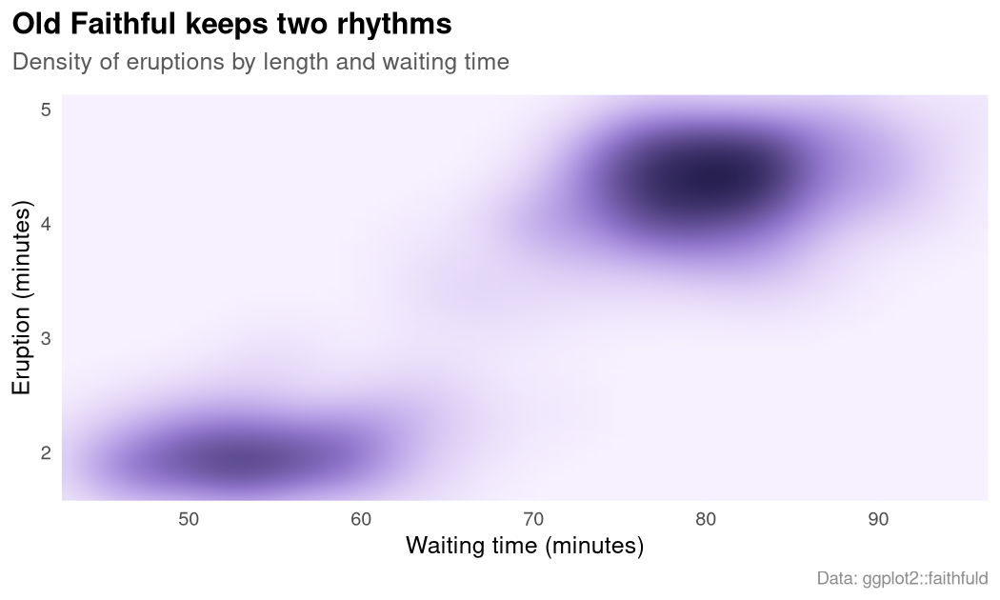</td>
    <td>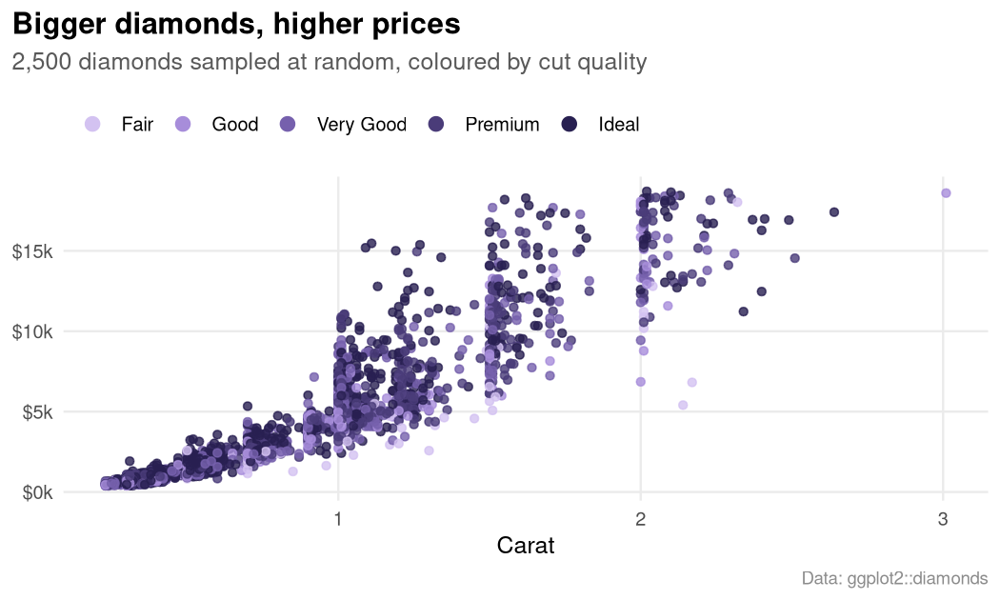</td>
  </tr>
  <tr>
    <td>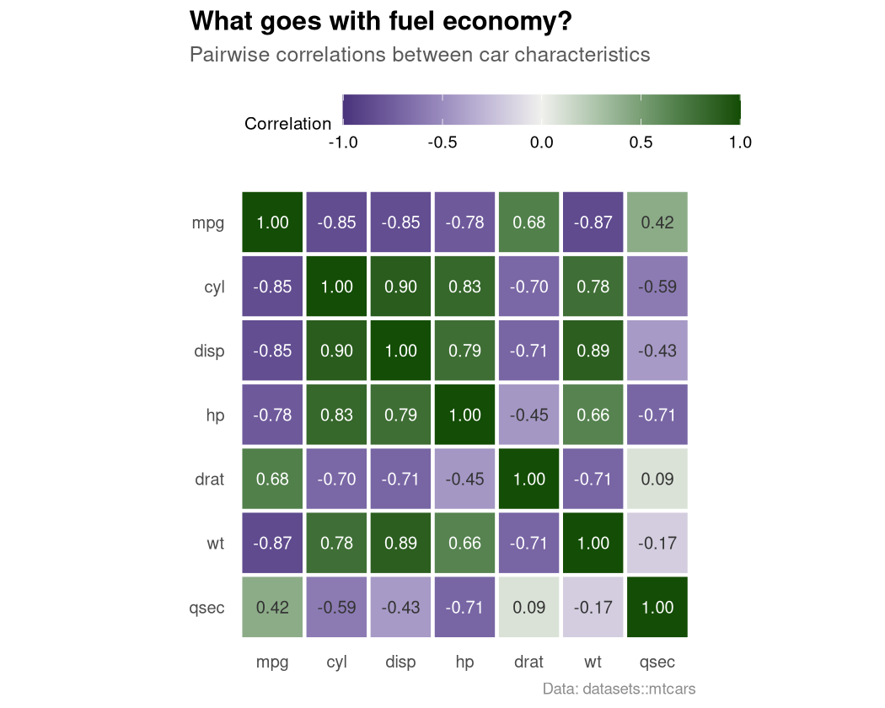</td>
    <td>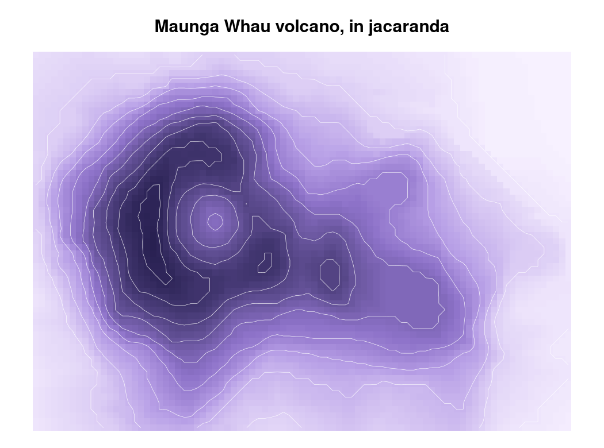</td>
  </tr>
</table>

The code for every plot is in the
[gallery vignette](vignettes/gallery.Rmd) (`vignette("gallery", package = "jacarandr")`).

## Installation

Install the development version from GitHub:

```r
# install.packages("remotes")
remotes::install_github("jazon7/jacarandr")
```

jacarandr only needs base R. ggplot2 is optional and only needed for the
`scale_*()` functions.

## Usage

### Get colours

```r
library(jacarandr)

jac_pal()                      # all 8 main colours
#> [1] "#8E73C9" "#3A7E2F" "#F28249" "#F2C83A" "#9CC0CF" "#C85382" "#42598B"
#> [8] "#352862"

jac_pal(n = 3)                 # the three most distinct
#> [1] "#8E73C9" "#3A7E2F" "#F28249"

jac_pal(n = 3, reverse = TRUE) # the same three, reversed
#> [1] "#F28249" "#3A7E2F" "#8E73C9"

jac_pal("seq", n = 5)          # any number from a continuous palette
#> [1] "#F7F1FF" "#C9B5ED" "#8E73C9" "#544585" "#282051"

jac_colours("jacaranda", "wattle")  # pick colours by name
#> jacaranda    wattle
#> "#8E73C9" "#F2C83A"
```

They work anywhere a colour vector does, including base graphics:

```r
barplot(1:5, col = jac_pal(n = 5))
image(volcano, col = jac_pal("seq", n = 50))
```

### See the colours

```r
jac_show()        # every palette
jac_show("main")  # one palette, labelled with names and hex codes
```

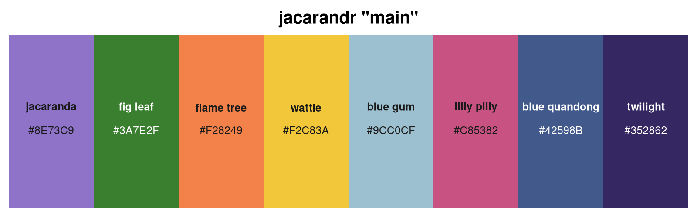

### ggplot2

Discrete scales end in `_d` and continuous scales end in `_c`. Every scale
takes `reverse`, and both British and American spellings work.

```r
library(ggplot2)

# Discrete
ggplot(mpg, aes(class, fill = drv)) +
  geom_bar() +
  scale_fill_jac_d()

# Continuous, reversed
ggplot(faithfuld, aes(waiting, eruptions, fill = density)) +
  geom_raster() +
  scale_fill_jac_c(reverse = TRUE)

# Diverging, with the neutral centre at zero
ggplot(cors, aes(x, y, fill = r)) +
  geom_tile() +
  scale_fill_jac_c(palette = "div", midpoint = 0, limits = c(-1, 1))
```

A discrete palette has 8 colours. If your data has more groups, jacarandr
stops with an error rather than reusing or inventing colours, because readers
cannot reliably tell more than about 8 categories apart. Group the smaller
categories together, or for ordered categories use
`scale_fill_jac_d(palette = "seq")`, which supplies any number of colours.

## Learn more

* `vignette("jacarandr")`: getting started, reversing and accessibility notes
* `vignette("gallery")`: the plots above, with their code

## Licence

MIT
